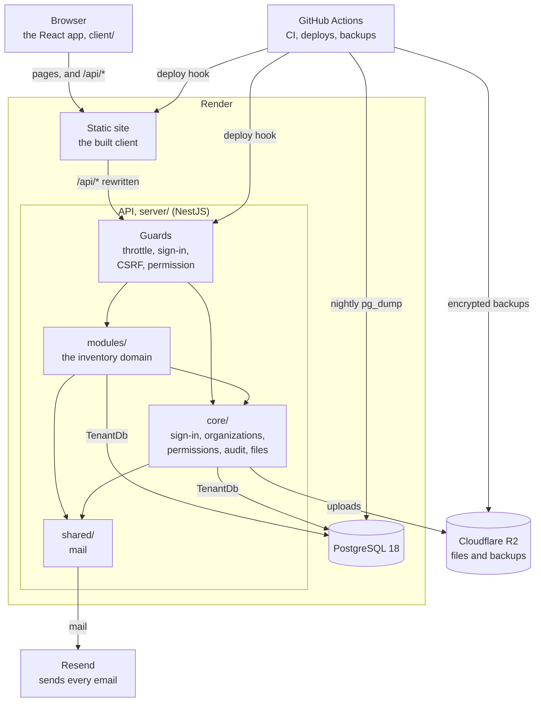

# Start here

One page to find the rest: the system as it runs, which document
answers which question, and where each one lives. Written by hand
([ADR-086](adr/0086-docs-as-code.md#amendment-october-2026--part-2-as-planned)).

## The system

- **The layering rule:** `modules/` depends on `core/` and `shared/`,
  never the other way round, and nothing in `core/` knows about stock or
  recipes ([README, Architecture](../README.md#architecture)).
- **Every query goes through `TenantDb`,** which scopes it to one
  organization ([ADR-003](adr/0003-multi-tenancy.md)).
- **Where each service's settings live,** and what moving off it would
  take: [the services runbook](runbooks/services.md).

## Which document answers which question

Grouped by [Diátaxis](https://diataxis.fr/)'s four kinds, with the
handoff beside them as status. A new document finds its kind here and
gets a row, in the commit that adds it; a file holds one kind, and one
that would mix two is two files.

### Tutorial: learning by doing

| Question | Answered in |
| --- | --- |
| How do I get the app running on my Mac? | [README, Setup](../README.md#setup) |
| Which commands are there, and what does each do? | [README, Commands](../README.md#commands) |

### How-to: a task, step by step

| Question | Answered in |
| --- | --- |
| How does an organization's staff do a task, such as issuing an invoice? | The Help guides, the app's Help, in three languages: [the English ones](../client/src/help/guides/en/) (a folder), invoices' in [invoices.md](../client/src/help/guides/en/invoices.md) |
| How is a change planned, built, verified and reviewed? | [engineering.md, How code is delivered](engineering.md#how-code-is-delivered) and [Commits](engineering.md#commits) |
| How is a migration added? | [engineering.md, Process](engineering.md#process), its steps in `server/`, with [conventions.md, Migrations against the running release](conventions.md#migrations-against-the-running-release-adr-081) and [A new table](conventions.md#a-new-table-and-the-organizations-export) |
| How is a new ADR written? | [engineering.md, Process](engineering.md#process), from [the template](adr/template.md) |
| Which tool do I run, and when? | [README, Which tool, when](../README.md#which-tool-when) |
| What do I check by hand before a release? | [manual-checks.md](manual-checks.md) |
| How do I deploy, rebuild the services, or replace the database? | [runbooks/render.md](runbooks/render.md) |
| How do I take a backup, or restore one? | [runbooks/restore.md](runbooks/restore.md) |

### Reference: the facts, to look up

| Question | Answered in |
| --- | --- |
| What does the app allow, refuse and work out in one area? Can a credit note give back more than is left of its invoice, and which test proves it? | [docs/rules/](rules/README.md), one file per area, invoices first; each rule linked to its ADR and its test |
| How is code named and organised, and what is the API contract? | [conventions.md](conventions.md) |
| What does an endpoint take and return? | [`server/openapi.json`](../server/openapi.json), written by `npm run api` from the server's code ([ADR-068](adr/0068-openapi-from-the-server-the-clients-types-generated.md)) |
| Which word does the app use for a thing, in each language? | [glossary.md](glossary.md) |
| Which outside services does the app use, with which settings? | [runbooks/services.md](runbooks/services.md) |
| What must Claude keep true in this repository? | [CLAUDE.md](../CLAUDE.md), loaded in every session |
| What must Claude keep true in one area's code, such as stock, and when does it load that? | [`.claude/rules/stock.md`](../.claude/rules/stock.md) for stock: one file per area, `<area>.md`, whose `paths` at its top list the area's files; Claude Code loads it when it reads, writes or edits one of them, on the server or the client |
| Where do the mark's files come from? | [brand/README.md](brand/README.md) |
| What went into each release? | [releases/](releases/) (a folder), one note per tag, as [v0.7.0.txt](releases/v0.7.0.txt) |

### Explanation: why it is so

| Question | Answered in |
| --- | --- |
| Why is it built this way? Why Drizzle and not Prisma? | [The ADRs](adr/README.md), by number and by area; for Drizzle, [ADR-009](adr/0009-drizzle-for-schema-migrations-and-queries.md) |
| What is still undecided, and what was thought so far? | [adr/open-decisions.md](adr/open-decisions.md) |
| What does the product aim for? | [principles.md](principles.md) |
| How is the system put together, and why that way? | [README, Architecture](../README.md#architecture) |

### Status: where the work stands

| Question | Answered in |
| --- | --- |
| Where does the work stand, and what is next to build? | [handoff.md](handoff.md) |
| Which issues are open, and in which area? | [The open issues](https://github.com/Zhenzhong-Zhou/web-app-foundation/issues), labelled as [engineering.md, Issues and labels](engineering.md#issues-and-labels) says |

## The docs' folders

- [`docs/`](./)
  - [README.md](README.md): Start here, this page.
  - [adr/](adr/README.md): the decisions, one file each.
    - [README.md](adr/README.md): what an ADR is here, and the indexes
      by number and by area, written by `scripts/adr-index.mjs`.
    - [template.md](adr/template.md): a new ADR's front matter and
      headings.
    - [open-decisions.md](adr/open-decisions.md): questions not yet an
      ADR.
  - [brand/](brand/README.md): the mark's masters.
  - [releases/](releases/) (a folder): the notes each tagged release was
    made with.
  - [rules/](rules/README.md): what the app allows, refuses and works
    out, by area.
    - [invoices.md](rules/invoices.md): the first.
  - [runbooks/](runbooks/) (a folder): running production.
    - [render.md](runbooks/render.md): the host, deploys, the database.
    - [restore.md](runbooks/restore.md): backups and restores.
    - [services.md](runbooks/services.md): every outside service.
  - [conventions.md](conventions.md): naming, code organisation, the API
    contract.
  - [decisions.md](decisions.md): where the ADRs were until October
    2026, now pointing to them.
  - [engineering.md](engineering.md): the working agreements.
  - [glossary.md](glossary.md): the app's words in three languages.
  - [handoff.md](handoff.md): where the work stands.
  - [manual-checks.md](manual-checks.md): what a person checks by hand.
  - [principles.md](principles.md): what the product aims for.

And outside `docs/`:

- [README.md](../README.md): what the project is, setup and commands.
- [CLAUDE.md](../CLAUDE.md): the rules in brief, for Claude.
- [`.claude/rules/`](../.claude/rules/) (a folder): Claude's code rules,
  one `<area>.md` per area, as [stock.md](../.claude/rules/stock.md).
- [`.claude/skills/`](../.claude/skills/) (a folder): the project's
  skills, as [`/code-review`](../.claude/skills/code-review/SKILL.md).
- [`client/src/help/guides/`](../client/src/help/guides/) (a folder): the
  Help guides, in English, French and Chinese.
- [`server/openapi.json`](../server/openapi.json): the API, as OpenAPI
  3.1.
