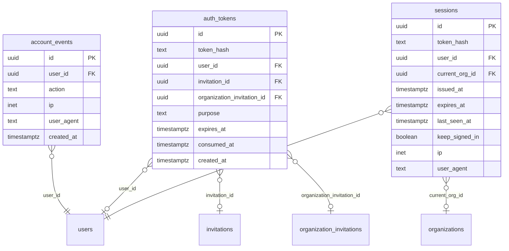

# Tables: auth

The tables of auth and their foreign keys, written from the Drizzle
schema by `npm run diagrams` in `server/`. [The index](README.md) says
how to read the diagram.

From other areas, drawn bare:

- [invitations](invitations.md): `invitations`, `organization_invitations`
- [organizations](organizations.md): `organizations`
- [users](users.md): `users`
