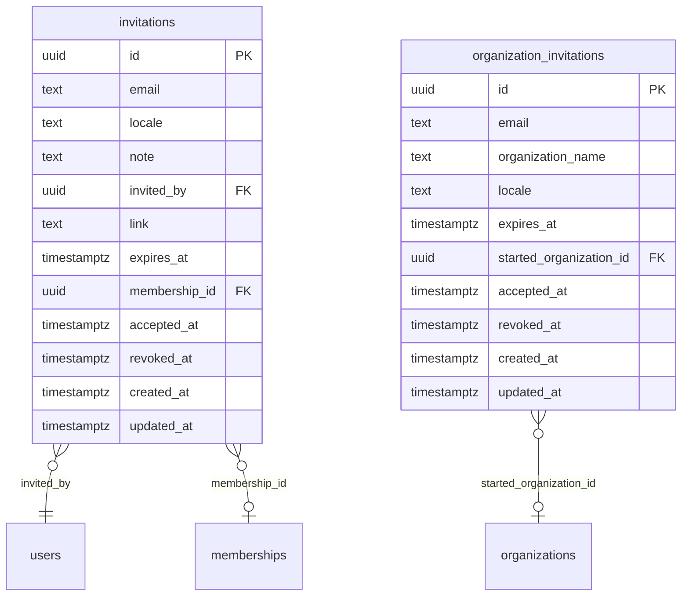

# Tables: invitations

The tables of invitations and their foreign keys, written from the Drizzle
schema by `npm run diagrams` in `server/`. [The index](README.md) says
how to read the diagram.

From other areas, drawn bare:

- [organizations](organizations.md): `memberships`, `organizations`
- [users](users.md): `users`
