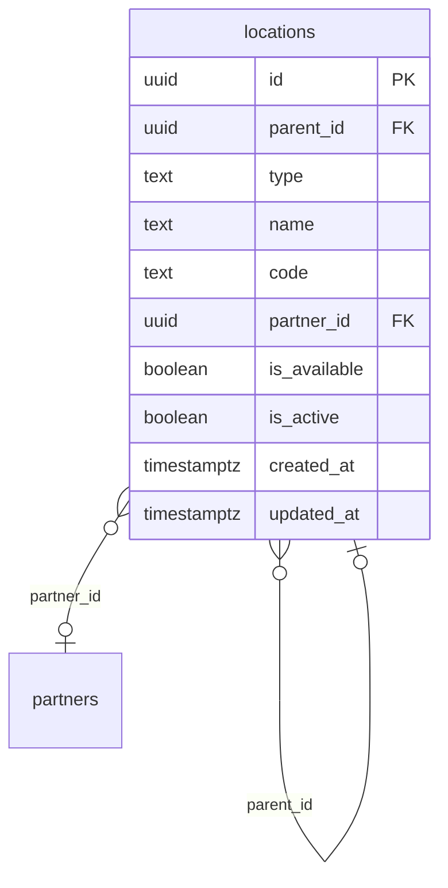

# Tables: locations

The tables of locations and their foreign keys, written from the Drizzle
schema by `npm run diagrams` in `server/`. [The index](README.md) says
how to read the diagram.

From other areas, drawn bare:

- [partners](partners.md): `partners`
