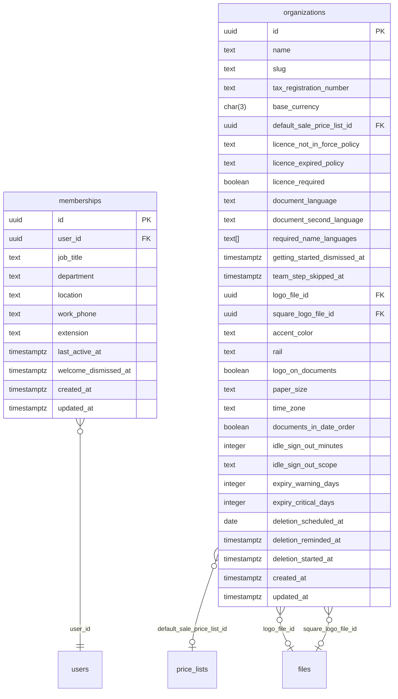

# Tables: organizations

The tables of organizations and their foreign keys, written from the Drizzle
schema by `npm run diagrams` in `server/`. [The index](README.md) says
how to read the diagram.

From other areas, drawn bare:

- [price-lists](price-lists.md): `price_lists`
- [files](files.md): `files`
- [users](users.md): `users`
