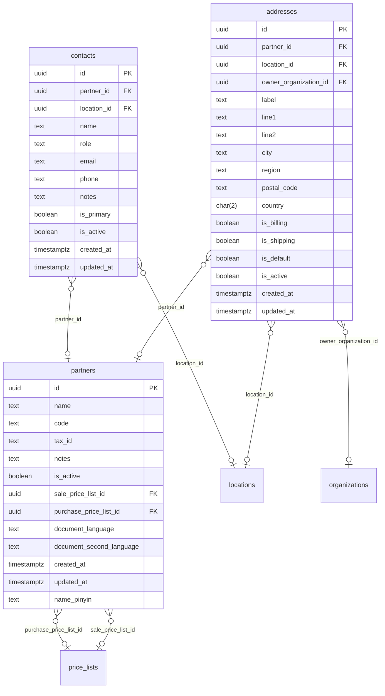

# Tables: partners

The tables of partners and their foreign keys, written from the Drizzle
schema by `npm run diagrams` in `server/`. [The index](README.md) says
how to read the diagram.

From other areas, drawn bare:

- [locations](locations.md): `locations`
- [price-lists](price-lists.md): `price_lists`
- [organizations](organizations.md): `organizations`
